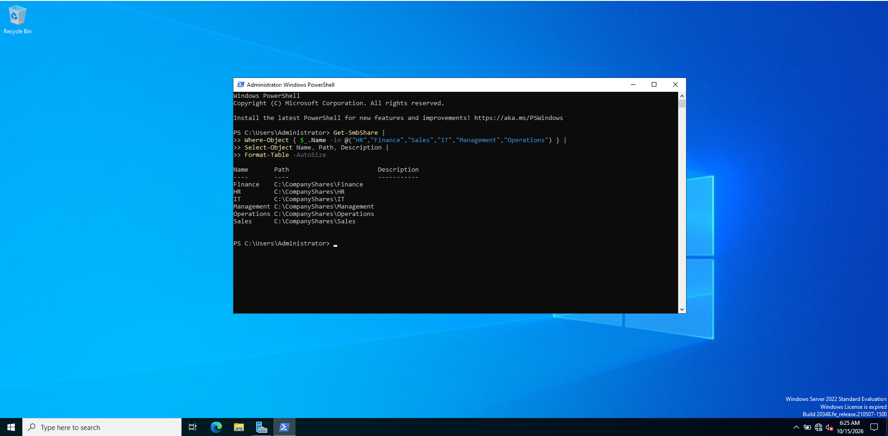
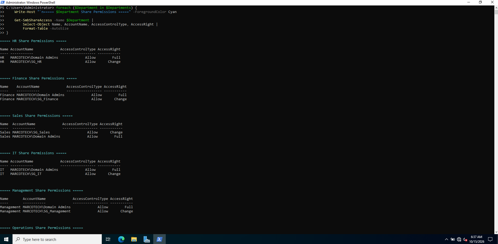

# Windows File & Print Services Lab

## Project Overview

This project demonstrates the deployment, configuration, and troubleshooting of Windows File and Print Services in a simulated enterprise environment using Windows Server 2022 and Windows 10.

The lab builds upon an existing Active Directory environment to implement secure departmental file sharing, role-based access control, SMB authentication, and a centrally managed shared printer.

The project also demonstrates practical troubleshooting, network connectivity testing, and validation of user access permissions.

## Lab Objectives

- Configure secure SMB file shares for six business departments.
- Implement role-based access control using Active Directory security groups.
- Configure NTFS and SMB share permissions following the principle of least privilege.
- Validate authorised access and prevent unauthorised access to departmental resources.
- Install and configure the Windows Server Print Services role.
- Deploy a shared printer accessible from a Windows client.
- Test virtual print output without requiring physical printer hardware.
- Troubleshoot authentication, networking, and printing issues.

## Lab Environment

| Component | Configuration |
|---|---|
| Hypervisor | Oracle VirtualBox |
| Domain Controller / File & Print Server | Windows Server 2022 (DC01) |
| Client | Windows 10 Home (PC01) |
| Active Directory Domain | Marcotech.ltd |
| Server IP Address | 192.168.10.10 |
| Network | VirtualBox Internal Network (AD-LAB) |
| Departments | Sales, HR, Finance, IT, Management, Operations |
| Print Driver | Generic / Text Only |

**Note:** Windows 10 Home cannot join an Active Directory domain. The client accessed domain resources using explicitly supplied domain credentials.

## SMB File Sharing and NTFS Permissions

### Departmental Shared Folders

Configured six departmental shared folders on the Windows Server 2022 domain controller (DC01), located under:

`C:\CompanyShares\`

The following SMB shares were configured:

| Department | SMB Share | Active Directory Security Group |
|---|---|---|
| Sales | `\\192.168.10.10\Sales` | `SG_Sales` |
| Human Resources | `\\192.168.10.10\HR` | `SG_HR` |
| Finance | `\\192.168.10.10\Finance` | `SG_Finance` |
| IT | `\\192.168.10.10\IT` | `SG_IT` |
| Management | `\\192.168.10.10\Management` | `SG_Management` |
| Operations | `\\192.168.10.10\Operations` | `SG_Operations` |

### Role-Based Access Control

Implemented role-based access control (RBAC) using Active Directory security groups.

- Assigned departmental security groups **Change** permissions at the SMB share level.
- Assigned departmental security groups **Modify** permissions at the NTFS level.
- Maintained administrative access for domain administrators.
- Reviewed and corrected overly broad NTFS permissions to restrict unnecessary access.
- Verified permissions across all six departmental folders.

This configuration helps enforce the **principle of least privilege**, allowing employees to access their authorised departmental resources while restricting access to other departments.

### Permission Verification

Audited SMB share permissions and NTFS access control lists (ACLs) to verify the configuration.






### Client Access Validation

Tested access from Windows 10 client PC01 using the Active Directory Sales account `MARCOTECH\jsmith`.

**Authorised access:** Successfully authenticated to the Sales SMB share and created a test file.

**Unauthorised access:** Attempted to access the Finance share using the same Sales account and received an access-denied response.

These tests demonstrate that departmental permissions were enforced as intended.


## Windows Print Services Configuration

### Installing the Print Services Role

Installed the **Print and Document Services** role on Windows Server 2022 (DC01) to provide centralised printer management.

Verified that the Windows Print Spooler service was running using PowerShell:

```powershell
Get-Service Spooler
```

The service returned a `Running` status, confirming that the server was ready to process print jobs.

### Configuring a Shared Network Printer

Created a shared printer on DC01 using the following configuration:

| Setting | Configuration |
|---|---|
| Printer Name | `MARCOTECH-Office-Printer` |
| Print Server | `DC01` |
| Printer Driver | `Generic / Text Only` |
| Printer Share Name | `MARCOTECH-Office-Printer` |
| Initial Printer Port | `LPT1:` |
| Final Printer Port | Local Port pointing to a file |
| Printer Sharing | Enabled |

The printer was made available to network clients through the Windows print server.

### Connecting the Windows Client

On Windows 10 client PC01, accessed the server's shared resources using:

```text
\\192.168.10.10
```

Located the shared printer, connected to it, and submitted a Windows test page.

This demonstrated client-side discovery of the shared printer and print-job submission to the server.

### Troubleshooting the Print Queue

During initial testing, the print job entered an error state because the printer was configured to use `LPT1:`, but no physical printer was connected.

To resolve this issue in the virtual lab:

1. Created the directory `C:\PrintLabOutput` on DC01.
2. Configured a Windows Local Port pointing to an output file in that directory.
3. Used the `Generic / Text Only` printer driver to simulate printing.
4. Verified that a text output file was generated.
5. Confirmed that the print queue returned to a ready state with no pending jobs.

This approach enabled testing of the Windows printing workflow without requiring physical printer hardware.

### Final Printer Verification

Used PowerShell to verify the printer configuration:

```powershell
Get-Printer -Name "MARCOTECH-Office-Printer" |
    Format-List Name,DriverName,PortName,Shared,ShareName,PrinterStatus
```

The final configuration confirmed that the printer remained shared and used the configured virtual output port.

### Skills Demonstrated

- Windows Server Print Services installation
- Print Spooler service verification
- Shared network printer configuration
- Windows client printer connectivity
- Print queue troubleshooting
- Virtual printer output testing
- PowerShell printer administration

**Note:** This lab demonstrates shared printer configuration and virtual print-job processing. It does not involve a physical printer or a production printing environment.

## Troubleshooting and Lessons Learned

During this lab, several technical challenges were identified and investigated.

### 1. SMB Authentication Issues

**Issue:** The Windows 10 client initially experienced authentication problems when attempting to access shared resources using Active Directory credentials.

**Troubleshooting:**
- Verified connectivity between PC01 and DC01.
- Tested SMB connectivity over TCP port 445.
- Reviewed authentication behaviour and Windows security events.
- Reconnected to the departmental share using explicit domain credentials.

**Outcome:** Successfully authenticated as `MARCOTECH\jsmith` and accessed the authorised Sales share.

### 2. Network and DHCP Connectivity Issues

**Issue:** PC01 experienced DHCP lease problems and received an automatic private IP address (APIPA), preventing normal communication with the server.

**Troubleshooting:**
- Checked VirtualBox internal network settings.
- Verified the server's network configuration.
- Temporarily configured a static IPv4 address on PC01.
- Tested connectivity to DC01 and SMB port 445.

**Outcome:** Restored connectivity using a temporary static IP configuration. The underlying DHCP issue remains a separate troubleshooting task.

### 3. NTFS and SMB Permission Configuration

**Issue:** The initial permission configuration required review to ensure departmental resources were appropriately restricted.

**Troubleshooting:**
- Audited SMB share permissions.
- Reviewed NTFS access control lists.
- Removed unnecessary broad permissions where appropriate.
- Verified departmental security group access.
- Tested both authorised and unauthorised access.

**Outcome:** Confirmed that a Sales user could write to the Sales share but could not access the Finance share.

### 4. Print Queue Errors

**Issue:** The initial printer configuration used the `LPT1:` port, resulting in print queue errors because no physical printer was connected.

**Troubleshooting:**
- Inspected the print queue in Print Management.
- Created a directory for virtual print output.
- Changed the printer to a file-based Local Port.
- Submitted a test print job and inspected the output.

**Outcome:** Successfully generated a text output file and verified that the print queue returned to a ready state.

## Project Outcomes

This lab demonstrated the ability to:

- Configure and administer Windows Server file and print services.
- Apply Active Directory group-based permissions to departmental file shares.
- Troubleshoot SMB authentication and network connectivity.
- Validate access restrictions using real client-side tests.
- Configure and troubleshoot shared Windows printers.
- Use PowerShell and Windows administrative tools for verification.
- Document technical configurations, errors, and solutions for reproducibility.

## Key Technologies

`Windows Server 2022` · `Active Directory` · `SMB` · `NTFS` · `RBAC` · `PowerShell` · `Print Management` · `Windows 10` · `Oracle VirtualBox`

## Related Project

This project builds upon my previous Active Directory Enterprise Lab:

[Active Directory Enterprise Lab](https://github.com/Chammarco99/Active-Directory-Enterprise-Lab)

## Future Improvements

- Investigate and resolve the remaining DHCP lease issue.
- Test printer deployment through Group Policy using a domain-joinable Windows client.
- Expand file access auditing and event monitoring.
- Explore additional print server permissions and administrative controls.
